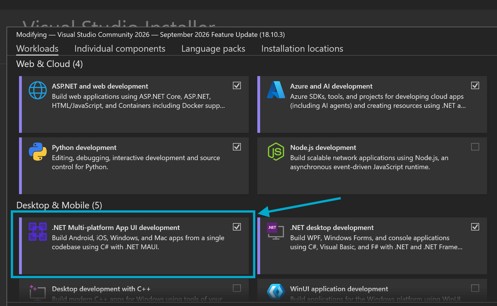
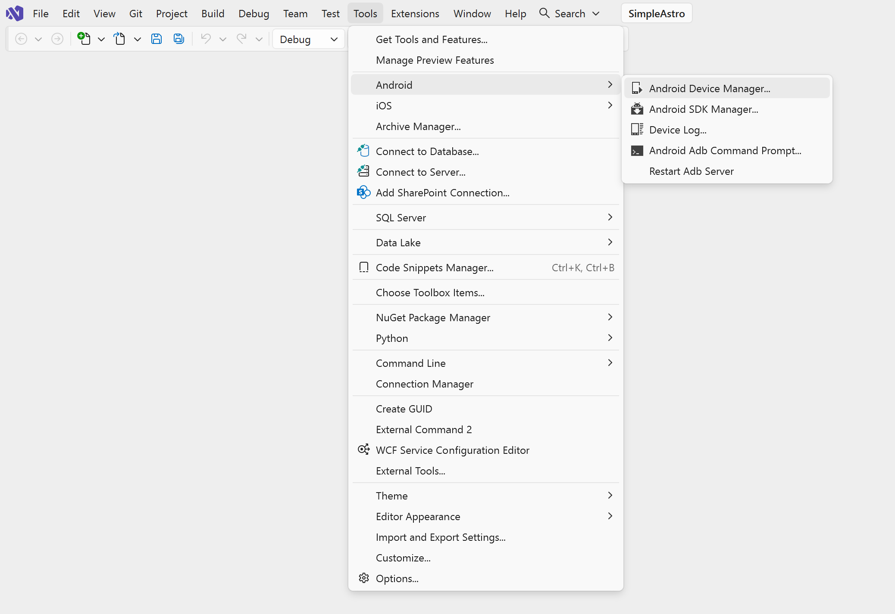
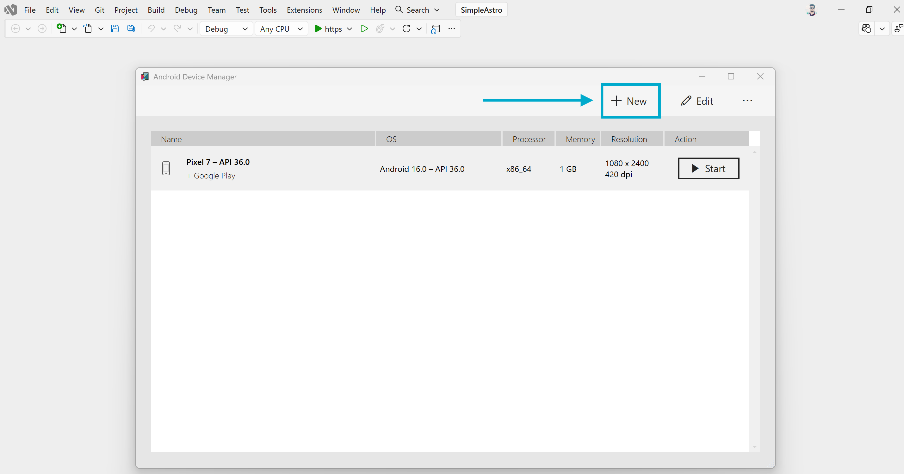
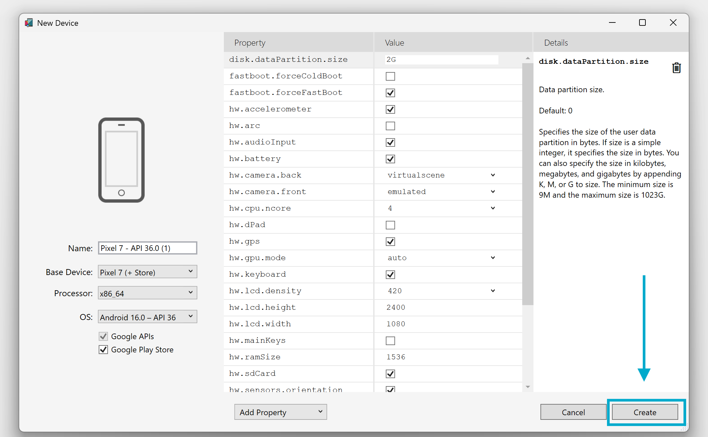

# Ultimate Angular

A cross-platform application built with **Angular 21**, **Electron 44** (desktop) and **Capacitor 8** (Android / iOS).

| Target                            | Tech                        | Output                   |
| --------------------------------- | --------------------------- | ------------------------ |
| Web                               | Angular                     | static files in `dist/`  |
| Desktop (Windows / Linux / macOS) | Electron + electron-builder | installers in `release/` |
| Mobile (Android / iOS)            | Capacitor                   | APK / AAB / IPA          |

---

## 1. Prerequisites

### 1.1 Common (all platforms)

| Tool        | Notes                                                                                                         |
| ----------- | ------------------------------------------------------------------------------------------------------------- |
| **Node.js** | Current LTS (22.x or newer). Angular 21 and Capacitor 8 need a recent Node.                                   |
| **npm**     | Project is pinned to `npm@11.12.1` (`packageManager` field). Run `corepack enable` or `npm i -g npm@11.12.1`. |
| **Git**     | To clone the repo.                                                                                            |

```bash
git clone <your-repo-url>
cd ultimate-angular
npm install
```

### 1.2 Android (Windows) - install Visual Studio 2026 first

We use **Visual Studio 2026** instead of Android Studio to get the Android SDK, JDK and emulator.
**Do this BEFORE running `npm install` / any `android:*` script.**

#### Step 1 - Install the workloads

1. Install **Visual Studio 2026 Community** (or higher).
2. Open **Visual Studio Installer** -> **Modify** -> **Workloads** tab.
3. Tick these workloads:

   | Category             | Workload                                   | Required?                                                 |
   | -------------------- | ------------------------------------------ | --------------------------------------------------------- |
   | Web & Cloud          | ASP.NET and web development                | optional                                                  |
   | Web & Cloud          | Azure and AI development                   | optional                                                  |
   | Web & Cloud          | Python development                         | optional                                                  |
   | **Desktop & Mobile** | **.NET Multi-platform App UI development** | **YES - this installs the Android SDK, JDK and emulator** |
   | Desktop & Mobile     | .NET desktop development                   | optional                                                  |

   

4. Click **Modify** and wait for the install to finish.

#### Step 2 - Open the Android Device Manager

You need _any_ project open in Visual Studio for the menu to be active (e.g. a blank/new project).

**Tools -> Android -> Android Device Manager...**



#### Step 3 - Create an emulator

1. In Android Device Manager click **+ New**.

   

2. Use these settings, then click **Create**:

   | Setting                         | Value                 |
   | ------------------------------- | --------------------- |
   | Name                            | `Pixel 7 - API 36.0`  |
   | Base Device                     | Pixel 7 (+ Store)     |
   | Processor                       | `x86_64`              |
   | OS                              | Android 16.0 - API 36 |
   | Google APIs / Google Play Store | enabled               |

   

3. Accept the licences / let it download the system image (a few GB).
4. Click **Start** next to the new device. Leave the emulator running.

> **Hardware acceleration:** the x86_64 emulator needs virtualization. Enable it in BIOS, and turn on
> **Windows Hypervisor Platform** (Windows Features) if the emulator fails to start.

#### Step 4 - Environment variables (needed by Capacitor / Gradle)

Capacitor and Gradle run outside Visual Studio, so they must be able to find the SDK and JDK.

| Variable           | Typical value (check yours)                       |
| ------------------ | ------------------------------------------------- |
| `ANDROID_HOME`     | `C:\Program Files (x86)\Android\android-sdk`      |
| `JAVA_HOME`        | `C:\Program Files\Android\openjdk\jdk-<version>`  |
| `ANDROID_SDK_ROOT` | `C:\Program Files (x86)\Android\android-sdk`      |
| `Path` (add)       | `%ANDROID_HOME%\platform-tools` (gives you `adb`) |

#### Step 5 - Start the emulator without opening Visual Studio (helper script)

Visual Studio is only needed for the **one-time setup** above. After the emulator has been created, you do **not** need to open
Visual Studio 2026 each time. The repo includes a helper script in the `helper/` folder that launches the emulator directly:

```text
helper/
  start-emulator.bat      <- double-click, or run from a terminal
```

```bash
helper\start-emulator.bat
```

Then run the app as usual (`npm run android:run:emulator`).

Notes:

- The script starts the emulator you created in Step 3. If you created it with a different name, open the `.bat` file and update the device name in it.
- The emulator uses an AVD name with underscores instead of spaces (for example `Pixel 7 - API 36.0` becomes something like `pixel_7_-_api_36_0`). To see the exact name, run `%ANDROID_HOME%\emulator\emulator.exe -list-avds`.
- The script relies on `ANDROID_HOME` from Step 4, so set that first.
- Wait until the emulator has fully booted (home screen visible) before running `npm run android:run:emulator`.

### 1.3 iOS (macOS only)

- macOS with the latest **Xcode** (App Store) and its command line tools: `xcode-select --install`
- An **Apple Developer** account (free for simulator/own device, paid programme for TestFlight / App Store).
- iOS cannot be built on Windows or Linux.

### 1.4 Electron cross-platform build notes

| Build target              | Build on                     |
| ------------------------- | ---------------------------- |
| Windows (`.exe`)          | Windows (best)               |
| Linux (`AppImage`, `deb`) | Linux (or WSL / Docker / CI) |
| macOS (`.dmg`)            | **macOS only**               |

Tip: use a CI matrix (GitHub Actions: `windows-latest`, `ubuntu-latest`, `macos-latest`) to build all three.

---

## 2. Angular web app

### Run (development)

```bash
npm start            # http://localhost:4200
```

### Test

```bash
npm test
```

### Build

```bash
npm run build
```

Output: `dist/ultimate-angular/browser/`

> Use `npm run build` for the **web**. The `build:ng` script sets `--base-href ./` and is meant for Electron and Capacitor
> (file:// / local loading). Using it for a normal web deployment can break deep links.

### Distribute

Upload the contents of `dist/ultimate-angular/browser/` to any static host: Azure Static Web Apps, Netlify, Vercel, GitHub Pages, S3 + CloudFront, IIS, Nginx.
Configure the host to **rewrite all routes to `index.html`** (SPA fallback).

---

## 3. Electron desktop app (Windows / Linux / macOS)

### Run

```bash
npm run electron:dev      # Angular dev server + Electron window with live reload
npm run electron:start    # builds Angular, then opens Electron against the built files
```

### Build installers

All scripts build Angular first (`build:ng`) and then call `electron-builder`. Output goes to **`release/`**.

| Platform             | Command                      | Output                           |
| -------------------- | ---------------------------- | -------------------------------- |
| Windows 32-bit       | `npm run dist:win32`         | NSIS installer + portable `.exe` |
| Windows 64-bit       | `npm run dist:win64`         | NSIS installer + portable `.exe` |
| Windows both         | `npm run dist:win`           | both of the above                |
| Linux x64            | `npm run dist:linux64`       | `.AppImage`, `.deb`              |
| Linux ARM64          | `npm run dist:linux-arm64`   | `.AppImage`, `.deb`              |
| Linux ARMv7          | `npm run dist:linux-armv7l`  | `.AppImage`, `.deb`              |
| macOS Intel          | `npm run dist:mac-intel`     | `.dmg`                           |
| macOS Apple Silicon  | `npm run dist:mac-silicon`   | `.dmg`                           |
| macOS Universal      | `npm run dist:mac-universal` | `.dmg`                           |
| Current OS (generic) | `npm run electron:build`     | default target for your OS       |

Files are named `UltimateAngular-<version>-<os>-<arch>.<ext>`.

### Before you ship - checklist

- Replace `appId` (`com.example.ultimateangular`) with your real reverse-domain id.
- Replace the placeholder `maintainer` in the `linux` section of `package.json`.
- Provide icons: `build/icon.ico` (Windows), `build/icon.icns` (macOS), `build/icons/` (Linux PNGs, e.g. 512x512).
- Bump `version` in `package.json` for each release.

### Distribute

- **Windows:** share the NSIS installer (`.exe`) or the portable `.exe`. For no SmartScreen warnings, sign with a code-signing certificate.
- **Linux:** share the `.AppImage` (`chmod +x`, then run) or the `.deb` (`sudo apt install ./file.deb`).
- **macOS:** share the `.dmg`. For distribution outside your own machine, sign and **notarize** with an Apple Developer ID, otherwise Gatekeeper blocks it.
- Host the files on GitHub Releases, your website, or a store (Microsoft Store, Snap Store, Mac App Store need extra config).

---

## 4. Capacitor mobile app (Android / iOS)

Capacitor wraps the built Angular app (`dist/`) in a native shell.
The `android/` and `ios/` folders are committed to the repo. If they are missing:

```bash
npm run build:ng
npx cap add android
npx cap add ios        # macOS only
```

> Make sure `webDir` in `capacitor.config.ts` points to the Angular output folder: `dist/ultimate-angular/browser`.

### Sync web code to native projects

Run this after **every** Angular change you want on the device:

```bash
npm run cap:sync
```

### 4.1 Android

#### Run on the emulator

1. Start the emulator with `helper\start-emulator.bat` (no Visual Studio needed, see section 1.2 Step 5). Alternatively, use **Tools -> Android -> Android Device Manager -> Start** in Visual Studio.
2. List targets and find the id (usually `emulator-5554`):

   ```bash
   npm run android:targets
   ```

3. Run the app:

   ```bash
   npm run android:run:emulator     # targets emulator-5554
   npm run android:run              # lets Capacitor ask which device to use
   ```

#### Run on a real phone

Enable **Developer options -> USB debugging**, connect via USB, confirm `adb devices` lists it, then `npm run android:run`.

#### Build a debug APK

```bash
npm run android:apk
```

Output: `android/app/build/outputs/apk/debug/app-debug.apk`

Install it on a running emulator / connected phone:

```bash
npm run android:install
```

> `android:apk` calls `gradlew` and works from `cmd`/npm on Windows. On macOS/Linux, run
> `cd android && ./gradlew assembleDebug` instead.

#### Build a release (for distribution)

1. Create a keystore **once** and keep it safe (losing it means you cannot update the app):

   ```bash
   keytool -genkey -v -keystore my-release-key.jks -keyalg RSA -keysize 2048 -validity 10000 -alias my-key-alias
   ```

2. Configure signing in `android/app/build.gradle` (or sign manually), then build:

   ```bash
   npm run cap:sync
   cd android
   gradlew bundleRelease      # AAB for Google Play
   gradlew assembleRelease    # signed APK for direct install
   ```

   Outputs: `android/app/build/outputs/bundle/release/app-release.aab` and `android/app/build/outputs/apk/release/`.

#### Distribute

- **Google Play:** upload the `.aab` in Play Console (one-time developer fee), go through internal testing -> production.
- **Direct / internal:** share the signed `.apk` (recipients must allow "install unknown apps").
- Before publishing, change `appId` in `capacitor.config.ts` and bump `versionCode` / `versionName` in `android/app/build.gradle`.

### 4.2 iOS (macOS only)

```bash
npm run ios:open     # sync + open the project in Xcode
npm run ios:run      # sync + run on a simulator / device
```

#### Distribute

1. In Xcode: select the app target -> **Signing & Capabilities** -> choose your Team and a unique Bundle Identifier.
2. Choose **Any iOS Device (arm64)** -> **Product -> Archive**.
3. In Organizer: **Distribute App** -> **App Store Connect** (TestFlight / App Store) or **Ad Hoc / Development** for registered devices.
4. Publishing requires a paid **Apple Developer Program** membership.

---

## 5. Script reference

| Script                                  | What it does                                                   |
| --------------------------------------- | -------------------------------------------------------------- |
| `start`                                 | Angular dev server                                             |
| `build`                                 | Angular production build (web)                                 |
| `watch`                                 | Angular build in watch mode (development config)               |
| `test`                                  | Unit tests (Vitest)                                            |
| `build:ng`                              | Angular build with `--base-href ./` (for Electron / Capacitor) |
| `electron:dev`                          | Dev server + Electron with live reload                         |
| `electron:start`                        | Build + launch Electron                                        |
| `electron:build`                        | Build + package for current OS                                 |
| `dist:win*`, `dist:linux*`, `dist:mac*` | Package for specific OS / architecture                         |
| `cap:sync`                              | `build:ng` + `cap sync`                                        |
| `android:targets`                       | List available Android devices / emulators                     |
| `android:run`                           | Sync + run on chosen Android device                            |
| `android:run:emulator`                  | Sync + run on `emulator-5554`                                  |
| `android:apk`                           | Sync + build debug APK                                         |
| `android:install`                       | Install debug APK with adb                                     |
| `ios:open` / `ios:run`                  | Sync + open Xcode / run on iOS (macOS)                         |

---

## 6. Troubleshooting

| Problem                                                        | Fix                                                                                               |
| -------------------------------------------------------------- | ------------------------------------------------------------------------------------------------- |
| `adb` / `java` not recognised                                  | Set `ANDROID_HOME`, `JAVA_HOME` and add `platform-tools` to `Path`, then open a **new** terminal. |
| `No target emulator-5554`                                      | Start the emulator first, then run `npm run android:targets` to get the real id.                  |
| Emulator will not start                                        | Enable virtualization in BIOS and Windows Hypervisor Platform.                                    |
| `helper\start-emulator.bat` cannot find the emulator or device | Check `ANDROID_HOME`, and make sure the AVD name in the `.bat` matches `emulator.exe -list-avds`. |
| Gradle: unsupported Java version                               | Point `JAVA_HOME` at JDK 21.                                                                      |
| Electron shows a blank page after `electron:start`             | Make sure Angular was built with `--base-href ./` (use `build:ng`, not `build`).                  |
| App shows old content on the phone                             | Run `npm run cap:sync` again before `android:run`.                                                |
| macOS `.dmg` / iOS fails on Windows                            | These can only be built on macOS. Use a Mac or a macOS CI runner.                                 |
| Blank screen in Capacitor                                      | Check `webDir` in `capacitor.config.ts` matches the real folder inside `dist/`.                   |

---

## 7. License / Author

Tejas Bhatt - tejas.mvc@gmail.com
